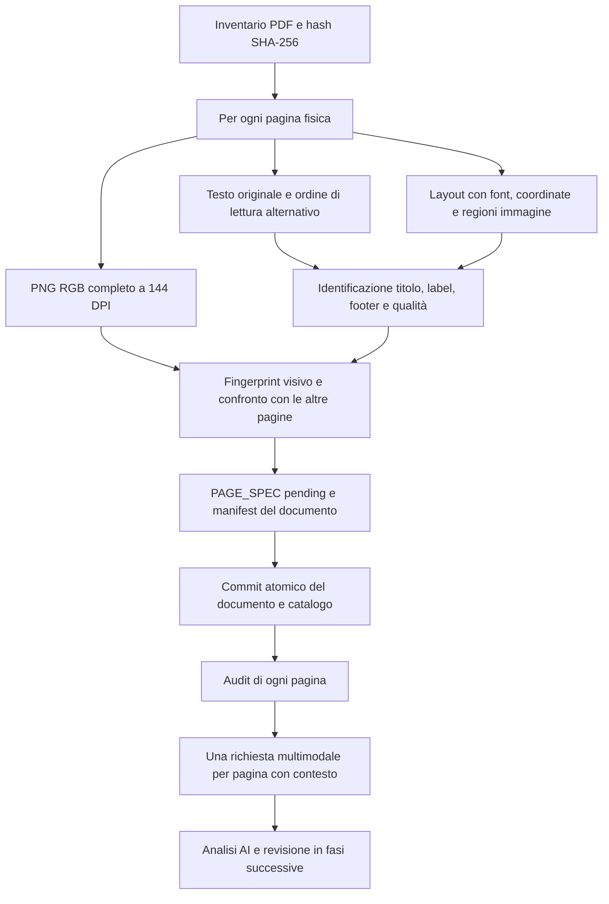

# Architettura del progetto

Aggiornamento PAGE ANALYSIS: sono state completate le 36 analisi individuali
dell'introduzione, senza implementare companion. Il registro e le discrepanze
della fonte sono in [INTRODUCTION_PAGE_ANALYSIS_AUDIT.md](INTRODUCTION_PAGE_ANALYSIS_AUDIT.md).
Le sezioni sulla prima consegna descrivono la pipeline iniziale; l'estensione
del contratto per gli enrichment è in [PAGE_SPEC_SCHEMA.md](PAGE_SPEC_SCHEMA.md).

## Obiettivo e confine della prima consegna

L'applicazione finale avrà a sinistra il PDF originale renderizzato con PDF.js,
con navigazione per pagina fisica; a destra una companion HTML/React a formato
slide fisso, sincronizzata tramite `page_id`. Esempi, grafici e simulazioni
appartengono alla companion e saranno implementati in fasi successive.

Questa consegna implementa esclusivamente l'ingestion e l'infrastruttura per
l'analisi. Non contiene UI didattica, companion, esempi numerici o analisi AI dei
contenuti del corso. Nessuna pagina è marcata come analizzata dopo la sola estrazione.

## Inventario verificato

| PDF originale | Pagine fisiche |
| --- | ---: |
| `OPTCON-RL_introduction_optimal_control_2026_09_14.pdf` | 36 |
| `OPTCON-RL_optimality_conditions_KKT_2026_10_08.pdf` | 20 |
| `OPTCON-RL_optimization_2026_09_14.pdf` | 81 |
| Totale | 137 |

Una pagina fisica, il suo numero stampato e la sua etichetta PDF sono identità
distinte. Nei PDF sono presenti etichette ripetute per gli overlay e prefissi
UTF-16 esposti nella forma `<FEFF...>`. Si conservano il valore grezzo e quello
decodificato. Il numero stampato nel footer viene estratto separatamente come
candidato con relativa posizione, senza usarlo come chiave.

## Directory implementate

```text
optconv2/
  *.pdf                         # Sorgenti originali, mai riscritte
  Docs/
    PROJECT_ARCHITECTURE.md
    PAGE_SPEC_SCHEMA.md
    IMPLEMENTATION_PLAN.md
  pipeline/
    __main__.py                 # CLI ingest/verify/export-analysis/import-analysis
    common.py                   # JSON atomico, hash, percorsi, validazione schemi
    ingest.py                   # Estrazione per pagina e manifest
    similarity.py               # Confronto testuale/visivo e delta
    analysis.py                 # Pacchetti multimodali e import dei risultati
    validate.py                 # Audit del corpus e dei singoli artefatti
  schemas/
    catalog.schema.json
    document-manifest.schema.json
    page-spec.schema.json
    analysis-result.schema.json
  prompts/analyze_page.md        # Protocollo versionato, indipendente dal provider
  tests/test_pipeline.py         # PDF sintetici temporanei e controlli negativi
  requirements.txt
  requirements.lock.txt
  Data/
    catalog.json
    documents/<document_id>/
      manifest.json
      fingerprints.json
      pages/0001/
        text.txt
        text.reading-order.txt
        layout.json
        render.png
        page_spec.json
    analysis/
      queue.jsonl
      coverage.json
      requests/<document_id>/0001.json
    reports/validation.json
    .staging/                   # Esecuzioni incomplete, mai visibili nel catalogo
```

## Flusso di ingestion



Ogni documento viene prima prodotto in una directory temporanea dedicata. Il
rename nella directory finale avviene solo quando tutte le sue pagine e il
manifest sono pronti. Un errore lascia `failure.json` in `.staging`; il catalogo
non viene aggiornato per dichiarare completo il corpus fallito. Non si saltano
silenziosamente pagine illeggibili. I file JSON sono scritti tramite sostituzione
atomica. La CLI è pensata per una sola esecuzione alla volta sullo stesso output.

Gli ID hanno forma `<nome-file>--<primi-12-caratteri-sha256>:p0001`. L'hash completo
rimane sempre nei manifest. Una modifica al PDF produce una nuova revisione del
documento; l'output precedente resta disponibile e il catalogo corrente punta
solo alle sorgenti attualmente rilevate. Due sorgenti omonime e identiche in
cartelle diverse vengono rifiutate come ambigue: vanno rinominate.

## Estrazione, rendering e qualità

`text.txt` conserva l'ordine originale del text layer; `text.reading-order.txt`
conserva l'ordinamento alternativo proposto dal motore. Nessuno dei due viene
trattato come una trascrizione affidabile della matematica. `layout.json`
conserva blocchi, righe, span, font, dimensioni, colori, coordinate e regioni delle
immagini raster; i disegni vettoriali rimangono visibili nel PNG completo.

Per l'ingestion si usa **PyMuPDF**, con rendering RGB, sfondo opaco, annotazioni
incluse e risoluzione predefinita 144 DPI. L'immagine non ricostruisce il layout
dal testo: rasterizza la pagina originale. La documentazione ufficiale descrive
[estrazione e rendering delle pagine](https://pymupdf.readthedocs.io/en/latest/page.html).

**PDF.js è il renderer previsto per il lettore web futuro** e leggerà il PDF
originale, non il PNG né una sua conversione HTML. Non è stato implementato un
lettore in questa fase. Il contratto userà `getDocument`, `getPage(page_index+1)`
e il viewport per il canvas, secondo gli [esempi ufficiali PDF.js](https://mozilla.github.io/pdf.js/examples/index.html).
Una verifica visiva tra i due motori farà parte dell'integrazione del lettore.

Pagine senza text layer, con testo scarso, simboli Unicode sostitutivi, titolo
non disponibile o rotazione producono avvisi espliciti. Non è installato né
eseguito un motore OCR: una pagina scansita viene comunque renderizzata e resta
da analizzare visivamente/OCR nella fase successiva. PDF cifrati senza accesso
leggibile interrompono l'ingestion con errore. La geometria e la matrice di
rotazione permettono di ricondurre le evidenze al layout non ruotato.

## Duplicate e slide progressive

Il confronto avviene all'interno di ciascun PDF; non viene effettuata una
deduplicazione tra corsi/documenti. Tutte le coppie vengono considerate per
duplicazione esatta/quasi duplicazione; le proposte progressive riguardano pagine
adiacenti. Il costo è quadratico nel numero di pagine del singolo PDF, adeguato
ai tre documenti attuali. Per migliaia di pagine servirà un indice di candidati.

Si distinguono:

- `exact_duplicate`: uguali hash dei pixel RGB dell'intera pagina e del testo
  originale. L'identità riguarda la rappresentazione archiviata alla risoluzione
  scelta, non l'identità binaria dei contenuti interni del PDF.
- `near_duplicate`: titolo o label compatibile, Jaccard multinsieme dei token
  almeno 0,88, differenza media visiva al massimo 0,075, sovrapposizione dell'inchiostro
  almeno 0,5 e almeno otto token di corpo in entrambe le pagine.
- `progressive_candidate`: pagine adiacenti con label ripetuta e raster diversi,
  oppure titolo condiviso e contenimento testuale almeno 0,80, con differenza
  visiva al massimo 0,14. Si ammettono aggiunte soltanto grafiche a testo identico.

Le firme approssimate escludono fascia del titolo e footer, riducono la pagina a
una griglia in scala di grigio e registrano anche un dHash. Il testo del corpo
esclude righe molto ricorrenti. Il confronto esatto conserva invece l'intera
pagina: intestazioni e numerazioni comprese. I punteggi `confidence` sono valori
euristici, non probabilità calibrate. Le soglie sono registrate nel manifest.

Per ogni coppia si conservano metriche, motivazione, righe aggiunte/rimosse e
rettangolo/frazione dei pixel cambiati sul raster RGB completo. Il delta è sempre
orientato dal numero fisico minore a quello maggiore, anche nella relazione
inversa. Le differenze di colore sono conservate nel delta RGB, pur potendo
sfuggire alla firma approssimata in scala di grigio. Titoli simili, layout comuni
e annotazioni possono produrre falsi positivi: occorre verifica multimodale.

I gruppi sono componenti connesse di candidati, non una dichiarazione transitiva
di equivalenza. Nessuna pagina viene eliminata, accorpata o privata della propria
richiesta AI. L'esecuzione iniziale ha prodotto 10 coppie progressive candidate,
una coppia quasi duplicata e nessuna coppia esatta.

## Contratto dell'analisi futura

Ogni richiesta contiene esattamente una target, le sue vicine fisiche immediate
quando disponibili e tutte le sue pagine correlate. Contiene testi e layout
completi, hash, immagini da allegare, protocollo e schema di risposta. Una pagina
di confine ha una sola vicina. I gruppi non sostituiscono l'analisi individuale.

`export-analysis` prepara file locali; non chiama un modello e non carica i PDF
su servizi esterni. L'adapter futuro deve inviare realmente i byte delle immagini
a un modello con capacità visive: i percorsi nel JSON non sono un input visivo.
La scelta del provider, batching, budget, retry e credenziali restano da implementare.

`import-analysis` verifica schema, hash del pacchetto, revisione del PDF, ispezioni
dichiarate di testo/layout/immagini, contesto di entrambe le vicine, citazioni
testuali esatte, coordinate delle evidenze, riferimenti fra osservazioni, copertura
formale e motivazione delle eventuali sub-page. Le osservazioni della target
devono avere evidenze sulla target, così non si attribuisce alla pagina un
contenuto visibile solo nella successiva. I risultati diversi già importati non
vengono sovrascritti implicitamente.

Gli stati sono `pending`, `analyzed` e `needs_review`. `analyzed` indica che una
risposta ha superato i controlli strutturali e non ha avvisi dichiarati; **non è
un'approvazione didattica o matematica**. Dubbi, avvisi di estrazione, valutazioni
progressive incerte e proposte di sub-page portano a `needs_review`. La revisione
umana, le sue decisioni e il relativo gate non sono implementati in questa fase.

La pipeline non può provare che un modello abbia osservato un'immagine né che la
copertura dichiarata sia semanticamente completa. Serviranno revisione delle
regioni visibili, verifica delle formule e dell'interpretazione prima della
generazione. Il report espone separatamente integrità, analisi e revisione.

## Mapping futuro e sincronizzazione

Il default è una pagina fisica PDF → una companion. Anche una progressiva o una
duplicata conserva il proprio mapping e il proprio stato. L'analisi può
raccomandare sub-page `a`, `b`, ecc. soltanto con una motivazione sul contenuto;
la presente implementazione registra la raccomandazione e lascia il mapping
effettivo `pending_analysis`. Non crea nemmeno companion vuote.

La futura UI manterrà `activeDocumentId`, `sourcePageIndex` e
`companionSubpageIndex`. Cambiare la pagina sorgente selezionerà la prima
companion relativa; cambiare sub-page manterrà fermo il PDF. Il layout fisso
della companion e il ridimensionamento nel pannello saranno separati dallo
stato delle simulazioni. Il contenuto didattico verrà modellato in un contratto
distinto dal PAGE_SPEC, che rimane un registro della sorgente e della sua analisi.

## Persistenza e verifiche

Gli artefatti usano percorsi relativi alla radice di output; i PDF usano percorsi
relativi a `source_root`, registrata come percorso locale nel catalogo. Per
spostare il corpus su un'altra macchina ricreare l'output dalla nuova radice; non
modificare a mano hash o analisi. Un aggiornamento del protocollo/schema richiede
la rigenerazione dei pacchetti e invalida i risultati riferiti al vecchio hash.
Prima di cambiare protocollo di un corpus già analizzato va creata una nuova
revisione: non esiste ancora una migrazione delle analisi.

`verify` controlla inventario PDF, checksum sorgenti, conteggi, schemi JSON,
sequenza degli indici, vicinanza, checksum di tutti gli artefatti, dimensioni e
pixel dei PNG, simmetria delle relazioni e validità dei risultati importati.
Controlla inoltre che coda e pacchetti AI coprano esattamente tutte le pagine,
includano gli allegati previsti e coincidano con protocollo, schema e sorgenti attuali.
I test aggiungono casi sintetici di duplicazione esatta, overlay esclusivamente
grafico, pagine senza testo, rotazioni e rifiuto di evidenze invalide.
